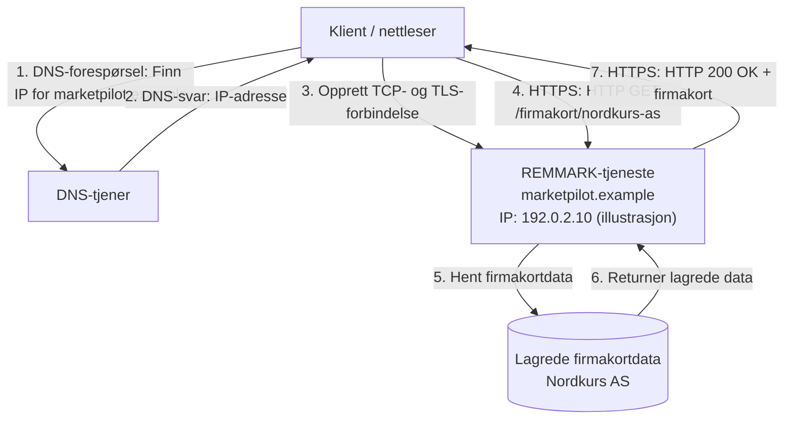

# Cloud Advisor

Cloud Advisor er et læringsprosjekt i Python som kombinerer programmering, kommersielle beregninger og grunnleggende cybersikkerhet.

Prosjektet benytter oppdiktede kundedata. Målet er å utvikle en løsning som kan støtte kunde- og salgsarbeid, samtidig som prosjektet gir praktisk erfaring med Python, funksjoner, testing og etter hvert identitets- og tilgangsstyring (IAM).

**Prosjektstatus:** Fungerende beregningsprototype. Tilgangsstyring er planlagt, men ikke implementert.

## 1. Behov og funksjonalitet

Bedriftskunder har behov for å forstå hva en lisenstjeneste vil koste, hvordan antall brukere påvirker prisen, og om løsningen passer innenfor et definert budsjett.

Cloud Advisor beregner:

- Månedskostnad før rabatt.
- Rabattsats basert på antall brukere.
- Rabattbeløp i kroner.
- Månedskostnad etter rabatt.
- Førsteårskostnad inkludert engangsoppsett.
- Om månedskostnaden etter rabatt er innenfor kundens månedsbudsjett.

### Rabattregler

| Antall brukere | Rabatt |
|---|---:|
| 1–9 | 0 % |
| 10–19 | 5 % |
| 20 eller flere | 10 % |

Rabatten gjelder hele månedskostnaden. Engangsoppsettet får ingen rabatt.

Førsteårskostnaden beregnes slik:

```text
(månedskostnad etter rabatt × 12) + engangsoppsett
```

En månedskostnad som er nøyaktig lik budsjettet, regnes som innenfor budsjettet.

### Implementerte Python-funksjoner

Prosjektet benytter tre funksjoner:

| Funksjon | Formål |
|---|---|
| `Manedskost()` | Beregner månedskostnad før rabatt |
| `forstear_ur()` | Beregner førsteårskostnad uten rabatt |
| `forstear_r()` | Beregner førsteårskostnad med rabatt |

Funksjonene tar imot nødvendige verdier som parametere og returnerer beregnede resultater. Funksjonen for førsteårskostnad uten rabatt er implementert, men resultatet skrives foreløpig ikke ut.

Rabattberegningen og budsjettkontrollen utføres fortsatt direkte i hovedprogrammet.

## 2. Slik kjører du programmet

Programmet krever Python 3 og bruker ingen eksterne pakker.

1. Åpne eller last ned Python-filen fra prosjektet.
2. Åpne filen i en kodeeditor.
3. Endre kundeopplysningene øverst i programmet.
4. Lagre filen.
5. Kjør programmet i terminalen.

Dersom filen heter `cloud_advisor_rabatt.py`, brukes:

```bash
python cloud_advisor_rabatt.py
```

På Windows kan følgende også brukes:

```bash
py cloud_advisor_rabatt.py
```

### Eksempeldata

Den nyeste kodeversjonen bruker:

```python
Kunde = "Nordlys AS"
Brukere = 25
Lisens = 150
Oppsett = 900
Månedsbud = 2707.5
```

Alle beløp oppgis i norske kroner.

### Forventet beregning

| Beregning | Resultat |
|---|---:|
| Antall brukere | 25 |
| Lisenspris per bruker | 150 kr |
| Månedskostnad før rabatt | 3 750 kr |
| Rabattsats | 10 % |
| Rabattbeløp | 375 kr |
| Månedskostnad etter rabatt | 3 375 kr |
| Engangsoppsett | 900 kr |
| Førsteårskostnad uten rabatt | 45 900 kr |
| Førsteårskostnad med rabatt | 41 400 kr |
| Månedsbudsjett | 2 707,50 kr |
| Budsjettavvik | 667,50 kr over |

**Forventet budsjettstatus: Over budsjettet.**

Dette viser hvordan Cloud Advisor kan gi en enkel økonomisk vurdering av et lisensbasert tilbud.

## 3. Testing og testresultater

Prosjektet har definerte, reproduserbare manuelle tester for rabattreglene og budsjettkontrollen.

Testverdiene nedenfor er beregnet fra reglene i programmet. Faktiske kjøreresultater må registreres etter gjennomføring. Testene er ikke dokumentert som bestått.

### Test A: Rabattgrenser

Faste testverdier:

```python
Kunde = "Testkunde AS"
Lisens = 150
Oppsett = 900
Månedsbud = 3000
```

Endre bare `Brukere` mellom hver kjøring.

| Test | Brukere | Rabatt | Måned etter rabatt | Første år | Faktisk resultat |
|---|---:|---:|---:|---:|---|
| R1 | 9 | 0 % | 1 350 kr | 17 100 kr | Ikke registrert |
| R2 | 10 | 5 % | 1 425 kr | 18 000 kr | Ikke registrert |
| R3 | 19 | 5 % | 2 707,50 kr | 33 390 kr | Ikke registrert |
| R4 | 20 | 10 % | 2 700 kr | 33 300 kr | Ikke registrert |

Alle fire testtilfellene skal være innenfor budsjettet på 3 000 kroner.

Overgangen fra 19 til 20 brukere er spesielt interessant. Månedskostnaden blir lavere ved 20 brukere fordi rabatten øker fra 5 % til 10 % og gjelder hele beløpet.

### Test B: Budsjettgrenser

Faste testverdier:

```python
Kunde = "Testkunde AS"
Brukere = 20
Lisens = 150
Oppsett = 900
```

Månedskostnaden etter rabatt skal være 2 700 kroner.

Endre bare `Månedsbud` mellom kjøringene.

| Test | Månedsbudsjett | Forventet status | Faktisk resultat |
|---|---:|---|---|
| B1 | 2 701 kr | Innenfor | Ikke registrert |
| B2 | 2 700 kr | Innenfor | Ikke registrert |
| B3 | 2 699 kr | Over budsjett | Ikke registrert |

Rabatt, månedskostnad og førsteårskostnad skal være uendret mellom testene. Bare budsjettstatus skal endres.

### Teststatus

**Implementert:** Beregningsfunksjoner, rabattregler og budsjettkontroll.

**Dokumentert:** Forventede resultater for syv manuelle testtilfeller.

**Gjenstår:** Registrere faktiske testresultater, kontrollere ugyldige inndata og etablere automatiserte tester.

## 4. Planlagt tilgangsstyring

Et naturlig neste steg for Cloud Advisor er å kunne håndtere flere kunder og brukere uten at informasjon deles med uvedkommende.

Tilgangsstyringen skal kombinere rollebasert tilgangskontroll (RBAC) med kontroll av kundetilhørighet.

### Roller og rettigheter

To roller er planlagt:

- **Leser:** Kan lese kundecaser.
- **Redaktør:** Kan lese og redigere kundecaser.

Rettighetene skal være knyttet til den enkelte kunden. Tilgang til én kunde skal ikke automatisk gi tilgang til andre kunder.

### Eksempel på tilgangsmatrise

**Nordkurs**

| Bruker | Lese | Redigere |
|---|---|---|
| Ingrid | Tillatt | Ikke tillatt |
| Bo | Tillatt | Tillatt |
| Eva | Ikke tillatt | Ikke tillatt |

**Fjordhandel**

| Bruker | Lese | Redigere |
|---|---|---|
| Eva | Tillatt | Ikke tillatt |
| Ingrid | Ikke tillatt | Ikke tillatt |
| Bo | Ikke tillatt | Ikke tillatt |

### Planlagt kontrollflyt

Når en bruker forsøker å lese eller endre et kundecase, skal systemet:

1. Bekrefte brukerens innloggede identitet.
2. Kontrollere at brukeren har tilgang til kunden.
3. Kontrollere at brukerrollen tillater handlingen.
4. Godkjenne handlingen dersom begge tilgangskravene er oppfylt.
5. Avvise handlingen dersom ett eller begge kravene ikke er oppfylt.

Dette bygger på prinsippet om minste privilegium, der brukere kun skal ha tilgang til informasjon og funksjoner de trenger.

### Eksempel på beslutninger

| Scenario | Forventet resultat | Begrunnelse |
|---|---|---|
| Ingrid leser Nordkurs | Tillatt | Har lesetilgang |
| Ingrid redigerer Nordkurs | Avvist | Mangler redigeringsrettigheter |
| Ingrid redigerer Fjordhandel | Avvist | Mangler kundetilgang |
| Bo redigerer Nordkurs | Tillatt | Har redigeringsrettigheter |

### Planlagt logging

Systemet skal kunne registrere tidspunkt, bruker, kunde, handling og resultat for tilgangsforsøk.

Eksempel på planlagt loggformat:

```text
21:01 | Ingrid | Redigere | Fjordhandel | AVVIST | Mangler tilgang
21:01 | Ingrid | Lese | Nordkurs | TILLATT | Lesetilgang bekreftet
```

Loggene skal gjøre det mulig å undersøke tilgangsforsøk og etterprøve sikkerhetsbeslutninger.

**Status: Tilgangsstyringen er dokumentert gjennom tilgangsmatriser og flytskjemaer, men ikke implementert i Python.**

## Planlagt REMMARK-tjeneste – nettverk og HTTPS

### 1. Behov og formål

REMMARK er en planlagt tjeneste på `https://marketpilot.example` som skal kunne vise firmakort for bedriftskunder.

I dette eksempelet ønsker en bruker å hente firmakortet til Nordkurs AS gjennom nettleseren. Firmakortdataene er oppdiktede og forutsettes allerede lagret hos REMMARK-tjenesten.

Formålet er å forstå hvordan klient, DNS, IP, TLS og HTTP samarbeider når informasjon hentes fra en nettjeneste.

Dette er en forenklet arkitektur med direkte kommunikasjon mellom nettleseren og tjenesten, uten mellomliggende proxy eller lastbalanserer.

### 2. Første skisse – klient og tjeneste

Den første skissen viser hovedkomponentene og informasjonsflyten:

```text
                   DNS
             Navneoppslag
                 ↑   ↓
                 |   |
             NETTLESER
                 |
                 | Forespørsel:
                 | Hent Nordkurs AS
                 ↓
           REMMARK-TJENESTE
                 |
                 | Leser data
                 ↓
           FIRMAKORTDATA
             Nordkurs AS
                 |
                 | Returnerer data
                 ↑
           REMMARK-TJENESTE
                 |
                 | Svar:
                 | Firmakort
                 ↓
             NETTLESER
```

Skissen viser at nettleseren først trenger en nettverksadresse for tjenesten. Deretter sendes en forespørsel, tjenesten henter lagrede firmakortdata, og nettleseren mottar svaret.

### 3. Forbedret skisse – DNS, IP, TLS og HTTP

Den første skissen er presisert for å vise hvor de ulike nettverksprotokollene benyttes.



**Forklaring av komponentene**

| Komponent | Funksjon |
|---|---|
| Klient | Nettleseren som ber om firmakortet. |
| Domenenavn | `marketpilot.example` er tjenestens planlagte adresse. |
| DNS | Oversetter domenenavnet til en IP-adresse. |
| IP | Gjør det mulig å adressere serveren på nettverket. |
| TLS | Kontrollerer serverens identitet via sertifikat og beskytter forbindelsen med kryptering. |
| HTTP | Definerer forespørselen og svaret mellom klienten og tjenesten. |
| REMMARK | Behandler forespørselen og henter riktig firmakort. |
| Firmakortdata | Oppdiktede kundedata som allerede finnes hos tjenesten. |

IP-adressen `192.0.2.10` brukes kun som illustrasjon. Domenet `marketpilot.example` er også et eksempel og er ikke ment å være et aktivt offentlig nettsted.

### 4. Eksempel på HTTPS-kommunikasjon

Nettleseren starter med et DNS-oppslag for å finne tjenestens IP-adresse.

Når adressen er kjent, opprettes en TCP-forbindelse og deretter en TLS-forbindelse til serveren.

Etter at TLS-forbindelsen er etablert, kan nettleseren sende HTTP-forespørselen gjennom den krypterte forbindelsen.

**Eksempel på HTTP-forespørsel:**

```http
GET /firmakort/nordkurs-as HTTP/1.1
Host: marketpilot.example
```

REMMARK-tjenesten undersøker om firmakortet finnes i sine lagrede data.

**Eksempel på vellykket HTTP-svar:**

```http
HTTP/1.1 200 OK
Content-Type: application/json
```

Svarinnholdet inneholder firmakortet til Nordkurs AS.

HTTPS betyr at HTTP-kommunikasjonen beskyttes med TLS. DNS-oppslaget er en separat del av prosessen og er ikke automatisk beskyttet av HTTPS-forbindelsen.

### 5. Feilsøking – tre separate observasjoner

Feilsøking bør starte på det nivået der problemet først oppstår.

| Observasjon | Mulig årsak | Første undersøkelse |
|---|---|---|
| Domenenavnet finnes ikke | Feil domenenavn eller manglende DNS-oppføring | Kontroller at domenenavnet er riktig skrevet og at forventet DNS-oppføring finnes. |
| Nettleseren viser sertifikatvarsel | Sertifikatet er utløpt, ikke betrodd eller samsvarer ikke med domenet | Kontroller sertifikatets gyldighet, tillitskjede og domenenavn. |
| HTTP-svar: Firmakort mangler | Feil firmakort-ID, feil endepunkt eller manglende data | Kontroller forespurt URL og kundeidentifikator, og undersøk om firmakortet finnes hos tjenesten. |

**Observasjon A – Domenenavnet finnes ikke**

Dersom DNS ikke klarer å finne domenenavnet, kan ikke nettleseren bruke det til å finne serveren.

Første undersøkelse er å kontrollere stavemåten og forventet DNS-konfigurasjon.

I dette prosjektet er `.example` et reservert eksempeldomene. At `marketpilot.example` ikke finnes i offentlig DNS, er derfor forventet og betyr ikke at en virkelig tjeneste har fått en feil.

**Observasjon B – Sertifikatvarsel**

Et sertifikatvarsel kan bety at nettleseren ikke klarer å bekrefte serverens identitet.

Første undersøkelse er å kontrollere at TLS-sertifikatet:

- Gjelder riktig domenenavn.
- Ikke er utløpt.
- Har en gyldig og betrodd sertifikatkjede.

Sertifikatvarsler skal ikke omgås som en permanent løsning. Problemet må undersøkes før tjenesten benyttes med sensitive opplysninger.

**Observasjon C – HTTP-svar om manglende firmakort**

Et HTTP-svar som `404 Not Found` kan bety at ressursen som etterspørres, ikke ble funnet.

Første undersøkelse er å kontrollere at riktig endepunkt og firmakort-ID er benyttet.

Deretter undersøkes om Nordkurs AS finnes i tjenestens lagrede data, og om applikasjonen slår opp riktig kunde.

Dette er i utgangspunktet en feil på applikasjonsnivå, ikke nødvendigvis en feil med DNS eller TLS.

### 6. Hvorfor DNS og HTTPS ikke er tilstrekkelig

**Fungerende DNS betyr ikke at riktig firmakort vises.**

DNS hjelper klienten med å finne IP-adressen til tjenesten. DNS kontrollerer ikke hvilket firmakort som blir hentet, eller om innholdet er korrekt.

Et vellykket DNS-oppslag kan derfor etterfølges av feil på serveren eller i applikasjonen.

**Fungerende HTTPS betyr heller ikke at firmainformasjonen er riktig.**

HTTPS kan gi kryptert kommunikasjon og bekrefte identiteten til serveren gjennom sertifikatkontroll.

Det betyr imidlertid ikke at applikasjonen nødvendigvis returnerer riktig informasjon.

Tjenesten kan eksempelvis:

- Hente firmakortet til feil kunde.
- Returnere utdatert informasjon.
- Ha feil kobling mellom firmakort-ID og kundedata.
- Vise data til en bruker som ikke har nødvendige rettigheter.

For å sikre riktig og autorisert firmainformasjon må REMMARK også kontrollere kundeidentifikator, datakvalitet og tilgangsrettigheter på applikasjonsnivå.

### 7. Rettelser og læringspunkter

Den første skissen viste hovedflyten mellom nettleser, tjeneste og data.

Den forbedrede skissen presiserer at:

1. DNS-oppslaget kommer før forbindelsen til tjenesten.
2. IP-adressen brukes til å nå riktig server.
3. TCP- og TLS-forbindelsen etableres før HTTP-forespørselen sendes.
4. HTTP-forespørselen og HTTP-svaret transporteres gjennom TLS.
5. Firmakortdataene hentes internt av REMMARK-tjenesten.
6. Sikker kommunikasjon ikke alene garanterer korrekt eller autorisert datatilgang.

Dette viser forskjellen mellom nettverkskommunikasjon, transportbeskyttelse og applikasjonens ansvar for data.

### 8. Begrensninger og videre arbeid

**Status: Planlagt og dokumentert – ikke implementert.**

Nettverksdiagrammene beskriver en tenkt løsning. Det er ikke gjennomført faktiske DNS-oppslag, HTTPS-tester eller HTTP-kall mot REMMARK.

Videre utvikling kan omfatte:

- Etablering av en faktisk webtjeneste.
- Konfigurering av domenenavn, DNS og TLS-sertifikat.
- Utvikling av et API for firmakort.
- Kontroll av kundeidentifikator og datatilgang.
- Implementering av rollebasert tilgangsstyring.
- Logging av forespørsler og feilsituasjoner.
- Tester for korrekte svar, manglende data og uautorisert tilgang.

Dette bygger videre på Cloud Advisor-prosjektets eksisterende arbeid med Python, kundedata, beregninger og planlagt tilgangsstyring.

**Læringsmål:** Forstå hvordan DNS, IP, TLS og HTTP samarbeider, hvordan nettverksfeil kan skilles fra applikasjonsfeil, og hvorfor sikker kommunikasjon må kombineres med korrekt databehandling og tilgangskontroll.

## 5. Begrensninger og videre utvikling

Cloud Advisor er foreløpig en læringsprototype, ikke en ferdig tjeneste.

### Kjente begrensninger

- Kundedata legges inn manuelt i Python-koden.
- Programmet mangler brukergrensesnitt og database.
- Negative verdier og ugyldige inndata blir ikke kontrollert.
- Rabattreglene er forhåndsdefinerte.
- Beregningene er ikke samlet i én felles funksjon.
- Testene er manuelle og mangler dokumenterte kjøreresultater.
- Brukerautentisering og tilgangsstyring er ikke implementert.
- Det finnes foreløpig ingen faktisk tilgangslogging.

### Planlagt utvikling

**Fase 1 – Forbedre beregningsmotoren**

- Samle rabatt- og kostnadsberegninger i gjenbrukbare funksjoner.
- Legge til kontroll av ugyldige inndata.
- Forbedre utskriften av økonomiske resultater.
- Skrive automatiserte tester for beregninger og budsjettgrenser.

**Fase 2 – Kundehåndtering**

- Utvikle en struktur for flere kunder.
- Skille kundedata fra beregningslogikken.
- Vurdere enkel lagring av kundedata.

**Fase 3 – Sikkerhet og tilgangsstyring**

- Implementere brukeridentitet og roller.
- Kontrollere kundetilhørighet ved hver forespørsel.
- Avvise handlinger uten nødvendige rettigheter.
- Innføre logging og tester av tilgangskontrollen.

**Fase 4 – Videre produktutvikling**

- Utforske et enkelt brukergrensesnitt.
- Vurdere database og API.
- Videreutvikle løsningen mot et mer komplett kunde- og lisensverktøy.

### Oppsummering

Cloud Advisor skal utvikles gradvis fra en enkel Python-kalkulator til et mer strukturert prosjekt som kombinerer kommersielle beregninger og sikker håndtering av kundedata.

Den eksisterende koden demonstrerer variabler, betingelser, funksjoner, beregninger og utskrift. Videre arbeid skal bygge på dette fundamentet med bedre testing, databehandling og tilgangskontroll.

Prosjektet brukes som praktisk læring innen Python, programvareutvikling og cybersikkerhet.
